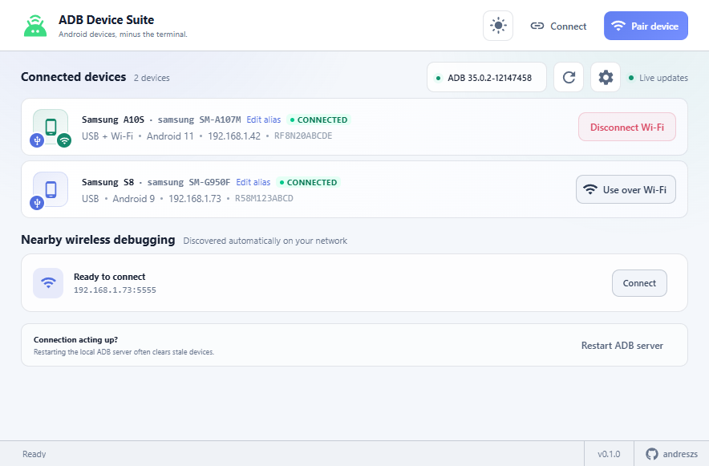
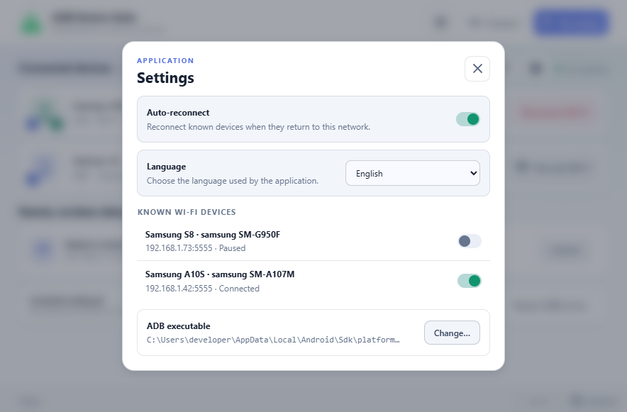

# ADB Device Suite

**Manage Android devices without the terminal.**

ADB Device Suite is a local-first desktop application for discovering, pairing, connecting and reconnecting Android devices over ADB. It is designed for developers who want the convenience of Android Studio's device connection tools without keeping an IDE or terminal open.

> [!NOTE]
> This project is under active development. The current `0.1.0` release line focuses on reliable device discovery and wireless ADB connections.

## Screenshots





## Features

- Groups the USB and Wi-Fi transports of each physical device into one card with model, Android version, connection types and status.
- Converts an authorized USB connection to classic TCP/IP mode with one click.
- Pairs Android 11+ devices using the six-digit wireless debugging code.
- Discovers pairing and connection endpoints advertised over mDNS.
- Saves successful network endpoints for quick reconnection.
- Automatically reconnects known Wi-Fi devices with bounded retry backoff.
- Tracks mDNS identities so known devices can be found after an IP address or debugging port change.
- Provides global and per-device auto-reconnect controls in Settings.
- Supports local aliases shared by the USB and Wi-Fi views of a device while always retaining its model name.
- Remembers the selected light, dark or system-following theme, with light as the first-run default.
- Detects the operating-system language on first run and lets the user freely switch between English, German, Spanish, French, Hindi, Portuguese, Russian, Japanese, Korean, Simplified Chinese and Traditional Chinese.
- Uses native-scale Material icons for sharp, legible controls.
- Explains unauthorized, offline and missing-ADB states in plain language.
- Runs locally; no account, telemetry or cloud service is required.
- Supports Windows 10+ and macOS.

## Requirements

- Android SDK Platform-Tools (`adb`). The app detects common Android Studio SDK locations automatically, or you can select the executable manually.
- USB debugging or Wireless debugging enabled in Android Developer options.
- For wireless connections, the computer and Android device must be able to reach one another on the same local network.

mDNS discovery depends on multicast traffic being allowed by the network. Guest Wi-Fi, client isolation, VLAN boundaries and some corporate access points may block it. The suite falls back to the last known endpoint when discovery is unavailable. Classic `adb tcpip 5555` may be disabled by a device reboot, in which case USB is required to enable it again.

Download Platform-Tools from the [official Android developer site](https://developer.android.com/tools/releases/platform-tools).

## Development

Requires Node.js 22 or later.

```bash
npm install
npm run dev
```

Other useful commands:

```bash
npm test        # parser and validation tests
npm run build   # type-check and build the renderer
npm run dist    # create a package for the current operating system
npm run dist:store # create the Windows Store package
```

## How wireless connections work

### Android 11 and newer

1. Open **Developer options → Wireless debugging** on the Android device.
2. Choose **Pair device with pairing code**.
3. In ADB Device Suite, select **Pair device** and enter the pairing endpoint and six-digit code.
4. Connect using the endpoint advertised by the device. Pairing and connection ports are usually different.

### Classic USB-to-Wi-Fi flow

1. Connect and authorize the Android device over USB.
2. Select **Use over Wi-Fi** in its device card.
3. The suite asks ADB to listen on TCP port 5555 and reconnects using the device's current Wi-Fi address.

## Packaging and releases

Pushing a version tag such as `v0.1.0` runs the release workflow for:

- Windows x64 (`.exe` installer)
- Microsoft Store x64 (`.appx`, accepted by the Store's MSIX submission flow)
- macOS Apple Silicon (`.dmg`)
- macOS Intel (`.dmg`)

The Store package uses the identity reserved for ADB Device Suite in Partner Center. Microsoft signs it during Store certification, so no separate Windows code-signing certificate is required. The standalone Windows installer remains unsigned, and macOS builds should be signed and notarized before they are promoted as stable downloads.

## Security

ADB Device Suite invokes the local `adb` executable with structured argument arrays and never interpolates device values into a shell command. Android's existing ADB keys and authorization flow remain in control. Saved connection endpoints and optional device aliases are stored only in Electron's local application-data directory.

Only enable wireless debugging on networks you trust.

## Roadmap

- Richer hardware information
- APK installation and package management
- File transfer
- Logcat viewer and export
- Screenshots and screen recording
- Common reboot and developer actions

## Contributing

Contributions are welcome. You can help improve ADB Device Suite by:

- Reporting reproducible bugs through [GitHub Issues](https://github.com/andreszs/adb-device-suite/issues).
- Suggesting focused features that keep the application practical and developer-oriented.
- Improving documentation, platform compatibility and automated tests.
- Submitting pull requests with a clear description of the change and how it was tested.

Before opening a pull request, run `npm test` and `npm run build` locally.

UI translations live in `src/locales/<locale>/ui.json`. English is the reference catalog; `npm test` reports any missing key in the other languages.

### Support development ☕💙

If ADB Device Suite is useful to you, consider supporting ongoing development and maintenance. Contributions help cover development tools and resources, enabling faster debugging, testing and quality-of-life improvements. 🛠️⚡

<p align="left">
  <a href="https://ko-fi.com/D1D716OLPM" target="_blank" rel="noopener noreferrer"></a>
  <a href="https://www.paypal.com/ncp/payment/GEEM324PDD9NC" target="_blank" rel="noopener noreferrer"></a>
  <a href="#usdc-arbitrum" rel="noopener noreferrer"></a>
</p>

> [!NOTE]
> If you cannot contribute financially, starring the repository is greatly appreciated. ⭐

<a id="usdc-arbitrum"></a>

#### USDC (Arbitrum network) address 🪙

```text
0xe36a336fC6cc9Daae657b4A380dA492AB9601e73
```

## License

[MIT](LICENSE) © Andrés Zsögön.

ADB Device Suite is an independent open-source project and is not affiliated with or endorsed by Google. Android and ADB are referenced solely to describe compatibility with Android SDK Platform-Tools.
